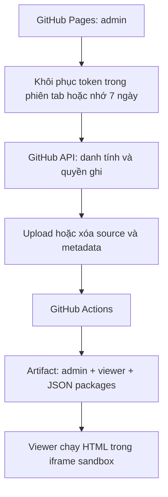

# Showcase — chỉ dùng GitHub Pages

Website upload HTML/CSS/JS, lưu source vào repo GitHub chung và tạo link xem giao diện. **Không cần Cloudflare, server, database hoặc GitHub App.**

Trang quản lý: https://kintinz.github.io/showcase/

## Cách sử dụng

1. Mở trang quản lý, chọn **Kết nối GitHub**.
2. Nhập personal access token (PAT) của chính bạn. Mặc định, token được nhớ bằng sessionStorage trong tab nên tải lại trang không cần nhập lại. Tích **Ghi nhớ trên thiết bị này trong 7 ngày** để lưu bằng localStorage và kết nối lại ở lần mở sau.
3. Ứng dụng kiểm tra danh tính và quyền repo. Tài khoản cần được cấp quyền ghi `Kintinz/showcase` để đăng hoặc xóa.
4. Chọn **Đăng giao diện**, upload HTML/ZIP, nhập tên và slug. Ứng dụng tự lưu source cùng metadata thành một commit.
5. Chờ GitHub Actions xuất bản xong, mở hoặc copy link gửi người khác. Người xem link không cần token.
6. Danh sách mặc định chỉ hiện giao diện do tài khoản đang kết nối đăng tải. Xóa cần là chủ sở hữu, còn quyền ghi repo và nhập đúng slug để xác nhận.

**Quyền sở hữu là quy tắc của ứng dụng, không phải ACL theo thư mục của GitHub.** Người có Write trên repo vẫn có thể sửa/xóa source trực tiếp bằng GitHub/Git. Source và metadata của repo public không riêng tư. Không đưa dữ liệu nội bộ nhạy cảm lên đây.

## Tạo token

Token không cấp thêm quyền ngoài những quyền tài khoản đã có. Chủ repo phải add tài khoản và người được mời phải chấp nhận lời mời trước.

- Nếu dùng được fine-grained PAT: chọn repo đích; **Contents: Read and write**, **Metadata: Read**, **Actions: Read** để theo dõi workflow. Không cần Workflows write, Administration hoặc secret của ứng dụng.
- GitHub có giới hạn fine-grained PAT đối với cộng tác viên trên repo public của tài khoản cá nhân khác. Trường hợp đó dùng PAT classic với scope **public_repo**; scope này rộng hơn một repo, nên đặt hạn sử dụng ngắn và tự thu hồi khi không cần nữa.
- Tạo token ở https://github.com/settings/tokens . Không đặt token trong source, URL, issue, chat hoặc cấu hình public.
- Repo public không có nghĩa người ngoài được ghi. Tài khoản Read/Triage/outsider bị khóa thao tác đăng/xóa trong ứng dụng; GitHub cũng thực thi quyền repo và scope token cho mỗi API request.
- Nếu branch protection không cho token ghi trực tiếp, thao tác sẽ bị từ chối. Không tự bỏ bảo vệ branch.

Ứng dụng chỉ gửi Authorization tới `https://api.github.com`, không chuyển tiếp qua server khác. Chỉ lưu token sau khi GitHub xác thực thành công; khi khôi phục vẫn kiểm tra lại danh tính và quyền repo. Không có đăng nhập OAuth, cookie HttpOnly hoặc API backend trong bản này.

**Nhớ kết nối:** chế độ mặc định dùng phiên tab của trình duyệt. Tùy chọn 7 ngày dùng localStorage; quá hạn thì xóa khi website đọc lại, không tự gia hạn mỗi lần tải trang. Nút **Ngắt kết nối** xóa token khỏi bộ nhớ và cả hai nơi lưu. HTTP 401 xóa token đã lưu; lỗi mạng/403 không tự xóa để người dùng còn thử lại. Khi trình duyệt chặn storage, vẫn có thể kết nối trong trang hiện tại và UI báo rõ không lưu được.

Token trong Web Storage có thể bị JavaScript cùng origin đọc nếu ứng dụng bị XSS. Chỉ bật ghi nhớ lâu trên máy cá nhân. Sandbox viewer vẫn được giữ để mã upload không đọc được storage trang quản lý. Ngắt kết nối không thu hồi token trên GitHub và không đăng xuất các tab khác đang giữ token trong bộ nhớ.

## CI/CD và bật Pages

Trong **Settings → Pages → Build and deployment**, chọn **Source: GitHub Actions**. Nếu chọn Deploy from a branch, Jekyll có thể hiển thị README thay cho ứng dụng quản lý.

- `check.yml`: Pull Request vào main, push main hoặc chạy thủ công → kiểm tra cú pháp, tests và build toàn bộ site.
- `pages.yml`: push main hoặc chạy thủ công → job build chạy kiểm tra, tạo artifact, upload artifact → job deploy chỉ chạy khi build đạt.
- Job build chỉ có Contents read; job deploy có Pages write và OIDC token. Không cần thêm secrets để deploy Pages.
- PAT người upload ghi commit vào main sẽ kích hoạt workflow. Không dùng token dùng chung và không dùng GITHUB_TOKEN trong trình duyệt.
- API Actions read giúp hiển thị lỗi/tiến trình chi tiết. Marker public theo commit + uploadId là bằng chứng bản xem đã sẵn sàng.

Mỗi deployment tạo artifact sạch: giao diện đã xóa không còn package trong bản mới. Repo main và default branch/Pages settings cần khớp; deployment environment không được giới hạn vào nhánh khác.

## Cách ly bản xem



Source vẫn lưu tại `projects/{slug}/`; artifact không phục vụ HTML/JS/SVG upload trực tiếp trên origin trang quản lý. Builder tạo `previews/{slug}.json` chứa source mã hóa base64. Viewer dựng blob URLs bên trong iframe `sandbox="allow-scripts allow-forms"`, không cấp same-origin, popup hoặc top-navigation. Mở tab mới và link `/{slug}/` đều qua viewer tin cậy.

Đây là cơ chế cách ly trình duyệt, không phải quét virus hay xác nhận code upload đáng tin cậy. Người nhận vẫn cần tự đánh giá nguồn giao diện.

## Source và chạy local

Yêu cầu Node.js 24+. Không cần npm install hoặc dependency bên thứ ba.

```powershell
node scripts/check.mjs
node scripts/dev.mjs
```

Mở `http://localhost:4173/showcase/`. Dev server build đúng artifact static, gồm base path `/showcase/`, rồi chỉ phục vụ file tĩnh. Nếu nhập PAT thật, trình duyệt gọi GitHub thật; chỉ thao tác upload/xóa khi có chủ đích.

Build thủ công:

```powershell
$env:GITHUB_SHA = git rev-parse HEAD
node scripts/build-showcase.ts
```

Artifact mới nằm trong `.build/pages-<timestamp>/`. Không ghi đè artifact cũ.

```text
admin/                       Trang quản lý tĩnh
admin/assets/client.js       GitHub PAT adapter + thao tác repo
admin/assets/config.js       owner/repo/branch public, không có token
worker/src/package.ts        Validation dùng chung, xuất thành JS khi build
worker/src/publish.ts         Commit tạo giao diện
worker/src/delete.ts          Commit xóa source/metadata của owner
worker/src/status.ts          Kiểm tra bản deploy theo commit/uploadId
viewer/                      Viewer và runtime sandbox
projects/{slug}/             Source upload trong repo
catalog/{slug}.json           ownerId, uploadId, name, slug, createdAt
scripts/build-showcase.ts     Tạo artifact tĩnh an toàn
scripts/check.mjs             Kiểm tra cú pháp + tests
.github/workflows/            CI và Pages CD
```

Các module core có đuôi .ts hiện dùng cú pháp JavaScript hợp lệ; builder chuyển import/extension sang .js cho trình duyệt. Không dùng TypeScript compiler và chưa có static typecheck.

Worker router/OAuth/GitHub App cũ và `wrangler.jsonc.example` chỉ được giữ để đối chiếu lịch sử, không được build/deploy hoặc cần cấu hình trong bản Pages. Không chạy fixture Worker cũ `tests/browser-fixture.mjs` với UI mới.

## Upload và giới hạn preview

- HTML đơn có CSS/JS inline hoặc ZIP thường có `index.html` ở gốc.
- Tối đa 2 MiB upload, 10 MiB giải nén, 2 MiB/file, 20 entry ZIP kể cả thư mục. Stored/deflate; không ZIP64, nhiều volume, mã hóa, symlink hoặc ZIP lồng.
- HTML, CSS, JS/MJS, JSON, PNG/JPEG/GIF/WEBP/SVG/ICO/AVIF, WOFF/WOFF2/TTF/OTF, TXT.
- Slug chữ thường/số/gạch ngang, tối đa 64 ký tự; không ghi đè slug đã có.
- Dùng đường dẫn tương đối cho file trong gói. Có hỗ trợ CSS url/import, script ngoài, ảnh/font, một số import module, fetch/XHR local, link sang trang HTML khác.
- Preview không phải môi trường hosting đầy đủ: không service worker, cookie/localStorage cùng origin, popup, framework cần build hoặc server-side API. Module import vòng và đường dẫn được tạo động phức tạp có thể cần gộp thành HTML độc lập trước khi upload. Tài nguyên từ CDN ngoài vẫn phụ thuộc CORS và chính sách CDN.
- Desktop/Tablet/Mobile chỉ đổi kích thước khung xem; cần kiểm tra thiết bị thật riêng.

## Xóa

Ứng dụng đối chiếu ownerId ổn định với user ID trả về từ GitHub, không chỉ username. Tạo một commit xóa source + metadata, không force push và không xóa lịch sử Git. Trong lúc chờ deploy, bản cũ có thể còn xem được; chỉ báo đã gỡ khi marker mới chứng minh slug đã biến mất. Không thu hồi được bản người xem đã tải/cache.

## Kiểm thử và giới hạn bằng chứng

```powershell
node --test tests/*.test.mjs
node tests/pages-browser-fixture.mjs
```

Fixture trình duyệt tại `http://localhost:4175/showcase/`, chỉ nhập token dùng riêng cho test `fixture-token`. GitHub được giả lập trong bộ nhớ, không có network write lên GitHub. Không nhập PAT thật vào fixture. Dừng process sẽ mất dữ liệu. Fixture và test token không được đưa vào artifact deploy.

Đã có unit/integration cho PAT, quyền, owner, upload/xóa, ZIP, commit conflict, deployment marker và artifact isolation; browser fixture kiểm tra UI và runtime sandbox. Không coi kết quả giả lập là bằng chứng PAT người dùng thật, branch protection hoặc deployment GitHub thật đã hoạt động.

## Tài liệu đối chiếu

- https://docs.github.com/en/rest/using-the-rest-api/using-cors-and-jsonp-to-make-cross-origin-requests
- https://docs.github.com/en/authentication/keeping-your-account-and-data-secure/managing-your-personal-access-tokens
- https://docs.github.com/en/rest/repos/repos#get-a-repository
- https://docs.github.com/en/rest/git/trees
