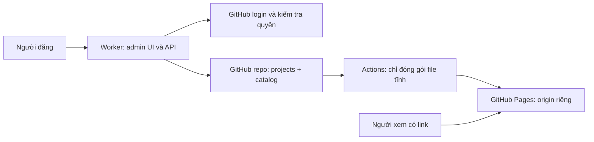

# Showcase

Website đăng tải giao diện HTML/CSS/JS để chia sẻ link xem và chốt UI. Source được lưu trong một GitHub repo chung; không sử dụng SQL/database.

## Hành vi đã triển khai trong source

- Đăng nhập GitHub; backend xác minh tài khoản bằng GitHub user access token.
- Chỉ tài khoản có quyền ghi hiệu lực trên repo đích được đăng hoặc xóa. Write/Maintain/Admin đều hợp lệ; Read/Triage/người ngoài repo không hợp lệ.
- Trang quản lý mặc định chỉ trả về giao diện do tài khoản đăng nhập upload. Chủ sở hữu gắn với GitHub user ID, không phụ thuộc tên tài khoản có thể thay đổi.
- Upload một HTML chứa sẵn CSS/JS hoặc ZIP có `index.html` tại gốc. Nhập tên và slug, tự tạo commit source cùng metadata.
- Xóa: phải là chủ sở hữu, còn quyền ghi và xác nhận slug. Source + metadata được xóa trong một commit. Không có ngoại lệ Admin xóa giao diện của người khác qua ứng dụng.
- Viewer Desktop/Tablet/Mobile, mở tab riêng, toàn màn hình, copy link.
- Tách trạng thái đã lưu GitHub với đã xuất bản. Bản xem chỉ sẵn sàng sau khi marker trên Pages chứng minh deployment có chứa commit.

**Trạng thái bàn giao:** source local và các kiểm thử tự động; chưa push, chưa tạo GitHub App, chưa cấu hình Cloudflare/GitHub Pages, chưa xác minh đăng nhập hoặc publish/xóa trên dịch vụ thật. Browser fixture là dữ liệu test trong bộ nhớ, không phải repo GitHub thật.

## Chạy và kiểm tra local

Yêu cầu Node.js 24 trở lên. Bản này không có dependency bên thứ ba và không cần `npm install`.

```powershell
node --test tests/*.test.mjs
node scripts/dev.mjs
```

Mở `http://localhost:4173`. Nếu chưa có biến môi trường, giao diện hiển thị trang đăng nhập và thông báo chưa cấu hình; không giả đăng nhập hoặc ghi GitHub. Dev server chỉ bind loopback. Luồng OAuth production cần HTTPS; Node dev server chỉ dùng kiểm tra UI/source, không thay thế Worker runtime.

Để kiểm tra UI với dữ liệu giả lập, chạy riêng:

```powershell
node tests/browser-fixture.mjs
```

Mở `http://localhost:4174/__fixture/login`. Tài khoản `demo-user` và source chỉ tồn tại trong bộ nhớ, dừng process sẽ mất. Fixture này KHÔNG được import hoặc deploy trong Worker. Các link dùng `preview.example.test` là placeholder để không nhầm với deployment thật.

## Kiến trúc



```text
admin/                   HTML/CSS/JS trang quản lý
worker/src/auth.ts       OAuth, session mã hóa, CSRF
worker/src/github.ts     GitHub App JWT, token và Git API
worker/src/permissions.ts Quyền ghi và quyền sở hữu
worker/src/package.ts    Kiểm tra file và giải nén ZIP
worker/src/publish.ts    Commit thêm source và metadata
worker/src/delete.ts     Commit xóa source và metadata
worker/src/status.ts     Theo dõi bản xuất bản theo commit
worker/src/index.ts      API router và admin assets
viewer/                  Khung xem trên Pages
projects/{slug}/         Source người dùng (tạo khi upload)
catalog/{slug}.json       Metadata gồm ownerId, uploadId, tên, slug, thời gian
scripts/build-showcase.ts Artifact Pages sạch theo catalog hiện tại
tests/                   Tests và browser fixture local
wrangler.jsonc.example   Mẫu cấu hình, chưa phải cấu hình deploy đang hoạt động
```

Mapping source `projects/demo/index.html` → artifact `demo/index.html` → `https://kintinz.github.io/showcase/demo/`.
Viewer: `https://kintinz.github.io/showcase/viewer/?slug=demo`.

Trang gốc Pages không liệt kê mọi giao diện. Danh sách cá nhân được truy xuất qua API đã đăng nhập. Người có link vẫn mở được giao diện công khai.

## Thiết lập dịch vụ — cần được chủ repo cho phép trước khi thực hiện

Các bước dưới đây là hướng dẫn, chưa được thực hiện tự động.

### 1. Đưa source lên repo

Repo đích: `Kintinz/showcase`. Repo ban đầu trống; cần đưa source này lên branch được chọn trước khi API có thể đọc cây Git và commit upload. Bản mẫu dùng `main`; không tự bypass branch protection.

Nếu ruleset không cho phép ứng dụng ghi trực tiếp, cần chốt branch dữ liệu riêng hoặc cơ chế tích hợp phù hợp trước. Khi đổi branch, cập nhật đồng bộ biến `GITHUB_BRANCH` và danh sách branch trong workflow. Chỉ owner thực hiện/cho phép thay đổi quyền và ruleset.

### 2. GitHub App

Tạo GitHub App và chỉ cài trên repo `Kintinz/showcase`.

Repository permissions cần dùng:

| Permission | Mức | Mục đích |
|---|---|---|
| Metadata | Read | Kiểm tra quyền người dùng trên repo |
| Contents | Read and write | Đọc source, tạo blobs/tree/commit và cập nhật branch |
| Actions | Read | Đọc workflow run để phản ánh tiến trình |

Không cấp quyền sửa workflow từ upload. Không cần webhook cho bản hiện tại. Mỗi người đăng cần authorize App bằng luồng đăng nhập.

Đặt callback URL chính xác: `https://<admin-origin>/api/auth/callback`.

GitHub App key cần định dạng PKCS#8 (`BEGIN PRIVATE KEY`). Nếu key tải xuống là PKCS#1 (`BEGIN RSA PRIVATE KEY`), chuyển trên máy quản trị bằng OpenSSL:

```text
openssl pkcs8 -topk8 -inform PEM -outform PEM -nocrypt -in github-app.pem -out github-app-pkcs8.pem
```

Giữ key ngoài repo. `.gitignore` đã bỏ qua `.pem`, `.env`, `.dev.vars`. Không gửi key hoặc secret qua chat.

### 3. Worker và admin assets

Mẫu `wrangler.jsonc.example` chứa cấu trúc binding `ASSETS` và các biến không bí mật. Tạo cấu hình hoạt động sau khi kiểm tra tài khoản Cloudflare và được cho phép; không deploy nguyên mẫu có `REPLACE_ME`.

Biến cấu hình:

| Tên | Giá trị |
|---|---|
| GITHUB_OWNER | Kintinz |
| GITHUB_REPO | showcase |
| GITHUB_BRANCH | main hoặc branch dữ liệu đã chốt |
| PREVIEW_BASE_URL | https://kintinz.github.io/showcase/ hoặc Pages domain thực tế |
| GITHUB_APP_ID | App ID |
| GITHUB_INSTALLATION_ID | Installation ID của App trên repo |
| GITHUB_CLIENT_ID | Client ID của GitHub App |

Secrets trong Cloudflare, không đặt trong frontend:

- `GITHUB_CLIENT_SECRET`
- `GITHUB_PRIVATE_KEY` — PEM PKCS#8 đầy đủ
- `SESSION_SECRET` — giá trị ngẫu nhiên tối thiểu 32 ký tự; đổi giá trị này sẽ làm hết hiệu lực phiên hiện tại

Đặt admin UI và API trên cùng origin HTTPS. `PREVIEW_BASE_URL` phải khác origin quản trị. Session là cookie HttpOnly/Secure/SameSite=Lax, mã hóa AES-GCM, tối đa một giờ. Không lưu token trong localStorage; sessionStorage chỉ giữ mã commit/slug/tiến trình.

Wrangler chưa cài vào dự án; cần xin phép trước khi cài hoặc chạy một công cụ tải package. Có thể dùng quy trình deploy Cloudflare sẵn có của tài khoản sau khi cấu hình được duyệt.

### 4. GitHub Pages

Trong repo, chọn Pages publishing source là GitHub Actions. Workflow `pages.yml` chạy trên push vào branch đã chọn hoặc `workflow_dispatch`. GitHub App installation token dùng để ghi commit; không dùng `GITHUB_TOKEN` của workflow làm token upload rồi kỳ vọng push kích hoạt workflow tiếp theo.

Workflow chạy tests, tạo artifact mới chỉ gồm viewer và các project còn trong catalog, rồi deploy. Marker chứa commit SHA và uploadId hiện tại của từng slug để phân biệt trường hợp xóa rồi tái sử dụng slug. Không copy admin, Worker, metadata owner hoặc secret vào artifact. Không thực thi code JS hay script build của người upload.

Chưa có cam kết chi phí bằng 0: hạn mức GitHub/Cloudflare tùy tài khoản và mức sử dụng. Cần kiểm tra CPU/subrequest thực tế của Worker khi tích hợp. Đọc catalog hiện tại dùng một GitHub blob request mỗi metadata; repo nhiều UI sẽ cần cân nhắc giới hạn runtime/API trước khi mở rộng.

## Định dạng và giới hạn upload

- HTML đơn được lưu thành `index.html`, không tự sửa nội dung HTML/CSS/JS.
- ZIP: tối đa 2 MiB nén, 10 MiB giải nén, 2 MiB mỗi file, 20 entry kể cả thư mục. Chỉ hỗ trợ ZIP thường, compression stored/deflate; không ZIP64, nhiều volume, mã hóa hoặc symlink.
- Loại file: HTML, CSS, JS/MJS, JSON, PNG/JPG/JPEG/GIF/WEBP/SVG/ICO/AVIF, WOFF/WOFF2/TTF/OTF và TXT.
- ZIP phải có `index.html` ngay tại gốc. Không tự tìm entry trong thư mục con.
- Chặn traversal, path tuyệt đối, thư mục ẩn, file trùng sau chuẩn hóa và archive lồng. Các file upload chỉ được ghi dưới `projects/{slug}/`.
- Slug tối đa 64 ký tự, chữ thường/số/gạch ngang. Slug tồn tại bị từ chối, không ghi đè.
- Dùng đường dẫn tương đối như `./assets/main.css`. Kiểm tra tĩnh chặn một số tham chiếu gốc domain và thẻ base; không thể chứng minh mọi URL được JS tạo động đều đúng. Kiểm tra Network sau xuất bản vẫn cần thiết.
- Viewer sandbox có script/form/modal/download, không cấp same-origin, popup hoặc điều hướng top. UI cần cookie/localStorage/module có CORS có thể không chạy đầy đủ trong khung sandbox; nút “Mở tab mới” mở trang độc lập trên origin preview để kiểm tra.

## Xóa và quyền sở hữu

Ứng dụng chỉ cho chủ sở hữu còn quyền ghi repo xóa project đó. API lấy `ownerId` từ metadata đã lưu, không tin owner do client gửi. Xóa đúng source slug và metadata trong một commit, giữ các UI khác. Xung đột branch được retry hữu hạn và kiểm tra lại quyền/owner, không force push.

Xóa khỏi branch hiện tại không xóa lịch sử commit và không thu hồi bản người xem đã tải/cache. Người có quyền ghi trực tiếp GitHub vẫn có thể thao tác ngoài ứng dụng theo quyền GitHub của họ; ứng dụng không tạo vùng cách ly bảo mật giữa các cộng tác viên có quyền ghi chung repo.

Sau commit xóa, source đã mất nhưng bản Pages cũ có thể còn phục vụ trong lúc chờ deploy. UI giữ tiến trình riêng và chỉ báo hoàn tất khi snapshot public mới không còn slug.

## Contract API

| Endpoint | Ý nghĩa |
|---|---|
| GET /api/auth/login | Bắt đầu đăng nhập GitHub |
| GET /api/auth/callback | Xác minh OAuth state và tạo cookie phiên |
| POST /api/auth/logout | Xóa cookie phiên; cần CSRF |
| GET /api/me | Danh tính, quyền publish, CSRF, repo và preview base; không trả token |
| GET /api/catalog | Chỉ metadata của user hiện tại |
| POST /api/publishes | Multipart `name`, `slug`, `file`; trả 202 với commit và status URL |
| DELETE /api/projects/{slug} | Xóa UI của chính user; trả 202 với commit và status URL |
| GET /api/publishes/{sha}?slug=... | Trạng thái thao tác của user theo commit |

Mọi mutation cần `Origin` khớp origin quản trị và header `X-CSRF-Token` từ `/api/me`. 401: hết/thiếu phiên; 403: thiếu quyền/không phải owner/CSRF; 404: không có project; 409: slug trùng hoặc xung đột Git; 413: quá dung lượng; 422: input không hợp lệ; 502/503: lỗi tích hợp/cấu hình. Lỗi có shape `{ error: { code, message } }`.

## Nghiệm thu trước khi đưa vào sử dụng

- Login thật với owner, collaborator Write, Read/Triage, outsider; kiểm tra cả API gọi trực tiếp.
- Upload HTML và ZIP thật; source + metadata nằm đúng repo, CSS/JS/ảnh/font hoạt động trên URL Pages có base path.
- Thu hồi quyền khi form còn mở: publish/delete bị chặn.
- Hai upload đồng thời không ghi mất UI; cùng slug chỉ một người thành công.
- Chỉ chủ sở hữu xóa; repo và bản Pages được gỡ đúng project, giữ UI khác.
- Deployment lỗi/hủy/được thay thế không bị báo thành công sai.
- Không có token/key trong bundle hoặc artifact; kiểm tra sandbox/origin bằng browser thật.
- Kiểm tra mobile thật riêng với mô phỏng viewport.

## Nguồn kỹ thuật đối chiếu

- https://docs.github.com/en/rest/collaborators/collaborators#get-repository-permissions-for-a-user
- https://docs.github.com/en/rest/git/trees
- https://docs.github.com/en/actions/how-tos/write-workflows/choose-when-workflows-run/trigger-a-workflow
- https://developers.cloudflare.com/workers/static-assets/binding/
- https://developers.cloudflare.com/workers/runtime-apis/web-standards/
- https://developers.cloudflare.com/workers/configuration/secrets/
