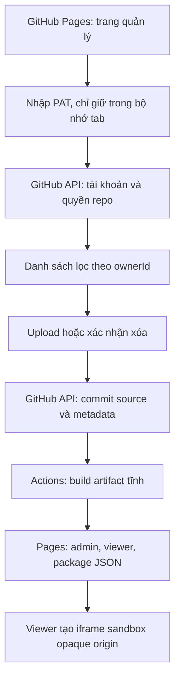

# Chuyển sang GitHub Pages, không backend

Yêu cầu đã được xác nhận trong chat: không server/hosting riêng/Cloudflare; mỗi người nhập token GitHub cá nhân; chỉ liệt kê và cho xóa giao diện của mình trong ứng dụng.

## Luồng và phạm vi

UI: giữ bố cục thư viện và form upload/xóa; thay nút đăng nhập bằng Kết nối GitHub, form nhập token kiểu password và hướng dẫn quyền. Reload/đóng tab mất token. Link xem không yêu cầu token.

Không publish HTML/JS/SVG do người dùng tải lên dưới dạng tài nguyên thực thi trên origin quản trị. Artifact chứa package JSON base64; viewer chỉ chạy source bên trong iframe srcdoc sandbox không allow-same-origin/top-navigation/popups. Link trực tiếp đến project và nút mở tab mới đều đi qua viewer an toàn.

Không có backend nên quyền sở hữu là quy tắc của ứng dụng. GitHub thực thi quyền repo/PAT, không phân quyền theo chủ từng thư mục. Người có Write vẫn thao tác ngoài ứng dụng được. Danh sách owner được lọc trong client; source repo public vẫn đọc được.

## Thứ tự thực hiện

1. Backup HEAD; viết test cho GitHub PAT adapter/client và artifact tĩnh cách ly.
2. Thêm client gọi GitHub API; tái sử dụng validation và commit/delete/status đã có, không dùng App token.
3. Đổi UI kết nối token và base path tương đối để chạy ở /showcase/.
4. Build admin + các core module JS + viewer + package JSON, không xuất source upload thực thi cùng origin.
5. Viewer xử lý asset tương đối, CSS/JS/ảnh/font trong package; liên kết nội bộ qua viewer. Không coi sandbox là trình duyệt nguyên vẹn cho service worker/localStorage/framework build.
6. Cập nhật CI kiểm tra/build trên PR, Pages deploy main, README và dev server tĩnh.
7. Chạy unit/integration, browser local, independent review; ghi rõ phần chưa thử bằng PAT người dùng thật. Không tự đọc credential trong máy để đưa lên trang.

## Kiểm chứng trọng yếu

- Token chỉ đến https://api.github.com, không local/sessionStorage/URL/marker/commit.
- Read/outsider, token hết hạn, quyền thu hồi: không ghi được.
- Catalog lọc ownerId; giả owner client không đổi metadata tạo bởi ứng dụng; chỉ owner còn Write xóa được.
- Artifact không chứa raw uploaded HTML/JS/SVG, token, config Worker hoặc source backend.
- Uploaded HTML cố truy cập parent/localStorage không thể đọc origin quản trị; asset tương đối và tương tác vẫn hoạt động.
- Status so đúng commit + uploadId, xóa rebuild không giữ package cũ.

Không cài dependency mới. Worker và các tests cũ được giữ để đối chiếu, không được bundle hoặc chạy trong bản triển khai Pages. Bản mẫu Cloudflare không được sử dụng nữa.
