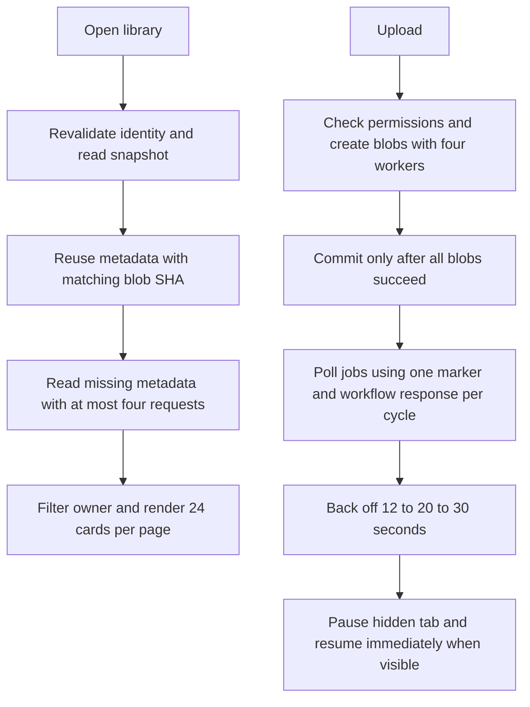

# Showcase performance P0 + P1

**Goal:** Measure scale and reduce redundant work without changing repository layout, permissions, preview isolation or deployment identity checks.

**Scope confirmed:** P0 + P1 only. No owner index, migration, build cache, CI configuration change or Git history rewriting.

## Approved flow

UI: below project cards add result range, previous/next page controls. Search covers all loaded owned projects and resets to page 1. Hide controls for a single page. Existing cards and dialogs retain their layout.

## Tasks
- [x] P0: reproducible 100/1000/5000 project benchmark for catalog requests/time and build bytes/time; retain baseline and optimized reports, no real PAT.
- [x] P1 reads/uploads: bounded parallel worker helper, per-adapter metadata cache keyed by blob SHA with bounded size and disconnect clearing, snapshot lookup map.
- [x] P1 progress: scoped memoization per batch, authorization and uploadId proof unchanged, one catalog refresh after ready jobs.
- [x] P1 UI: 24-item pagination, adaptive visibility-aware polling.
- [x] Validate cold/warm/changed metadata, account switching/revocation, upload failures/conflicts, job identity, pagination/search and browser smoke. Existing tests + build + diff check; independent review at end.

## Measurement limits
Synthetic local HTTP fixture times are not GitHub latency or production SLOs. Build dataset uses small HTML; report sizes explicitly. P1 still scans the entire tree and reads every metadata on cold load. Build output remains a complete snapshot.

## Results
See docs/performance-p0-p1.md and docs/performance-p0-p1-results.json. Browser verified 56 projects split 24/24/8, searching from page 3, mobile without horizontal overflow, and automatic upload-to-ready after fixing native timer receiver binding.

Ruling: Cache lives only in the connected adapter memory, bounded by record count and serialized byte size; no browser metadata persistence. Build still emits the complete snapshot. No implementation of P2.
