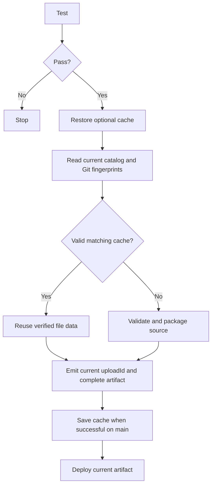

# P3 preview build cache and CI implementation

**Goal:** Reuse unchanged preview file packages and remove duplicate full checks/builds on main pushes, retaining full Pages artifacts and current upload identity.

**Architecture:** Optional CLI cache under .build/preview-cache. In a clean Git checkout matching the requested SHA, read tracked file blob SHAs once and group by project. Cache key includes sorted path/mode/blob descriptors; namespace includes packager/cache/validator code hashes and Node major version. Validate cached file paths, sizes, canonical base64 and Git blob hashes before reuse. Dirty or non-Git source uses the existing source packager. Cache is an optional optimization; absent/corrupt/unwritable cache falls back to source.

**Scope approved:** Script build, tests, check.yml/pages.yml, metrics and documentation only. No UI/contract change, dependency installation, branch-rule edits, push or deployment.

## Tasks
- [x] Back up source, inspect required checks and write failing cache/build tests and review workflow conditions.
- [x] Implement cache helper and optional backward-compatible build options; output build counts/time/bytes.
- [x] Keep preview envelope/marker fresh and artifact complete; ignore deleted projects even if cache remains.
- [x] Check workflow runs PR/manual; Pages workflow runs main push/manual, tests once before cached build/deploy. Cache restore/save only main; no secrets, no PR cache writes. Keep existing action versions; add official cache restore/save at pinned immutable revisions.
- [x] Benchmark no-cache/cold/warm/one-project change using identical data and compare output bytes; run all tests/build/diff checks and independent review.

## Flow

## Decisions/evidence
- main branch API returned protected=false on 2026-10-26; no branch rules modified.
- Fingerprinting dirty/non-Git source would require reading all source data, so use safe uncached build there. Metrics expose this fallback rather than claiming a cache speedup.
- Cached bytes are verified against Git blob SHA descriptors, not only a self-reported checksum from the cache.
- Build cache only contains file data, never owner/token/upload identity. SHA/uploadId envelope generated each build.
- Cache does not reduce Git checkout, full artifact upload or deployment time; benchmark must state this limit.

## Verification
- 61/61 tests passed, including cache equivalence, renamed/missing files, fresh identity, deletion, corruption/substitution, transformations and genuinely unavailable cache.
- Build CLI passed with --cache in the actual Windows checkout, correctly reporting source-fallback because autocrlf=true. No Git settings changed.
- Benchmark 100/1000 projects, 10 files/project: complete no-cache/cold/warm artifacts had identical SHA-256. At 1000 projects no-cache 14866ms, cold17851ms, warm5761ms, one-change5177ms (999 hits).
- Independent read-only review found no blocking regression. Two non-blocking notes were corrected: blocked-cache test now uses clean fixture; save key no longer depends on restore output.
- Workflow conditions/source reviewed locally. Hosted GitHub Actions cache restore/save and deploy have not been run; no push performed.
- No YAML parser/actionlint was available in local/bundled runtimes; no dependency was installed. Hosted workflow validation remains explicitly unverified until push.
- Full metrics and limitations: docs/performance-p3.md and docs/performance-p3-results.json.
