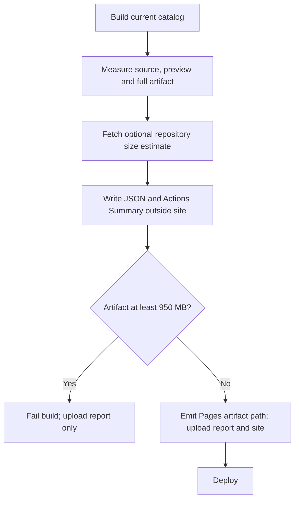

# P4 capacity reporting and deployment guard

**Goal:** Report active-source/preview/artifact/repository sizes, warn at 500/700/850 decimal MB and stop before Pages artifact upload/deploy at 950 MB.

**Architecture:** Pure capacity functions with boundary tests; collect decoded-source and encoded preview bytes during existing build, not another source scan. Optional GitHub repo metadata request from CLI uses runtime read-only token and returns size in API-reported KB or explicitly unavailable. JSON report lives beside, never inside, Pages output. CLI writes report/summary/outputs before enforcing the gate; workflows upload diagnostics even if the gate rejects the build.

**Approved scope:** build/report scripts, related workflows/tests/docs. No upload limit change, automatic deletion, branch/history rewriting, new hosting or UI. No push/deploy until separately requested.

## Steps
- [x] Back up existing sources; write failing boundary, totals/top-ten, API fallback and gate/report tests.
- [x] Implement scripts/capacity.mjs and integrate metric collection without changing preview contract or cache data.
- [x] Add CLI report emission and enforce before Pages outputs; keep report available after capacity failure.
- [x] Upload reports in Check/Publish workflows, including failed-capacity builds, before site artifact upload.
- [x] Verify cached and fresh builds, thresholds with mocked bytes, API unavailability/no secret leakage, existing tests, CLI and diff check; independent review.

## Constraints
- One MB = 1,000,000 bytes. Thresholds are project policy; 950 MB is conservative guardrail, not GitHub's own threshold.
- Repository API size is advisory, not a full Git history measurement. Unknown stays unknown; zero is valid only if API actually returned zero.
- Active source excludes orphaned/unlisted projects; repository size may include more data and history.
- Source is already committed when CI blocks deploy. Existing Pages remains; no automatic rollback/delete or token retention.
- No large generated files required to test policy; report/gate tests use synthetic counters.

## Results
- 65/65 tests passed; source/cache artifact metrics agree; all exact/adjacent thresholds use synthetic counters.
- CLI successfully built current zero-project catalog (90017 artifact bytes) and saved .build/reports-1793032638999/capacity.json, with GitHub advisory repository size 169 KB at observation time. These are local snapshot values, not a hosted P4 deployment.
- Independent read-only review found no blocking issue; 10/10 focused capacity/build/cache tests passed.
- Report upload after a hosted failed build remains unverified until push; no live workflow/deployment or branch/history modification performed.
- No UI changes or dependency installs. Limits unchanged.
